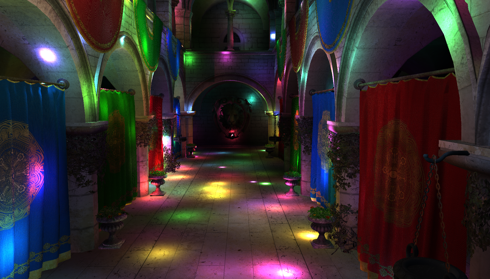
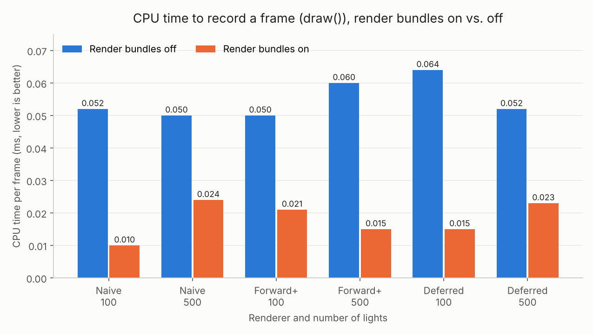
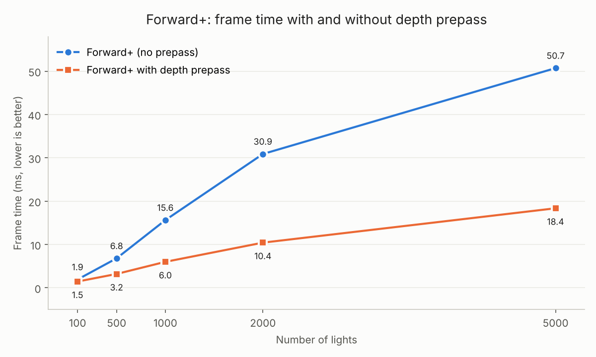
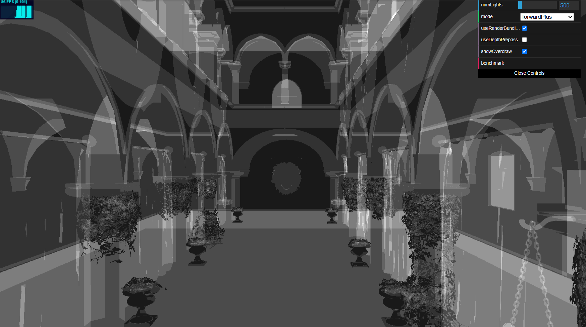
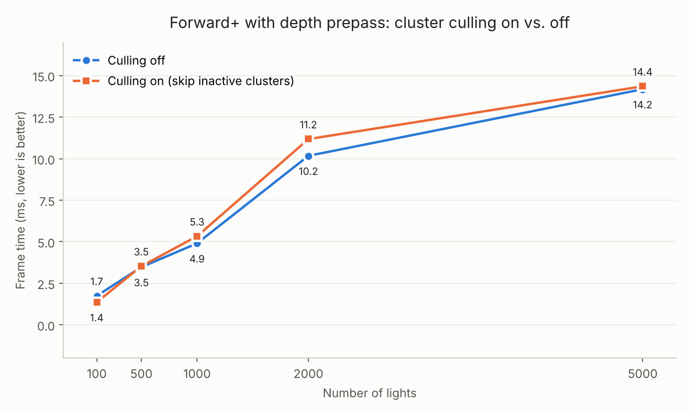
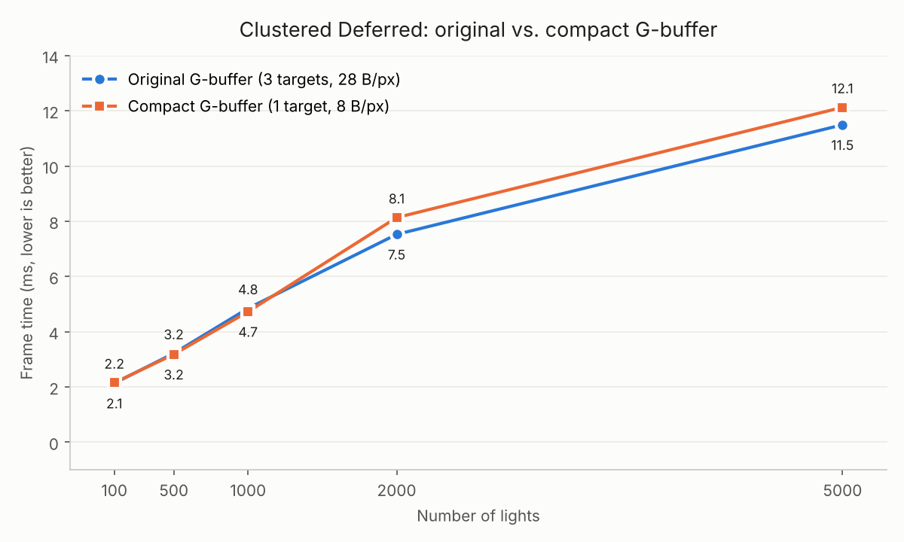

WebGL Forward+ and Clustered Deferred Shading
=============================================

**University of Pennsylvania, CIS 565: GPU Programming and Architecture, Project 4**

* Yunzhe Deng
  * [LinkedIn](https://www.linkedin.com/in/yunzhedeng), [personal website](https://yunzhedeng.com)
* Tested on: Windows 11, Intel Core i7-10750H @ 2.60GHz, 16 GB RAM, NVIDIA GeForce RTX 2060 (Personal Computer)

### Live Demo

### Demo Video/GIF

## Overview

This project is a real-time WebGPU renderer that draws the Sponza scene lit by hundreds to thousands of dynamic point lights. The core question it explores is how to shade a scene with many lights efficiently, so it implements three rendering pipelines that can be switched at runtime from the GUI, then adds a set of optimizations and effects on top of them and measures each one.

### Features

- Naive renderer
- Forward+ renderer
- Clustered Deferred renderer
- Post-processing (bloom or toon shading)
- G-buffer optimization
- Visibility buffer
- Render bundles
- Depth prepass for Forward+
- In-app benchmark tool

### Benchmarking

The built-in FPS counter is driven by `requestAnimationFrame`, which is locked to the display's refresh rate (100 Hz on the test machine), so every renderer faster than 10 ms per frame reads exactly 100 FPS and cannot be compared. To get real
frame times, I added a `benchmark` button to the GUI: it pauses the normal render loop, renders 20 warm-up frames and then 200 frames back-to-back, waits for the GPU to finish, and prints the average **milliseconds per frame** to the browser console. To use it, pick a `mode` and `numLights` in the GUI, click `benchmark`, and read the result in the console. All timings in this README were measured this way.

The benchmark also reports the CPU time spent inside `draw()` (recording and submitting commands, without waiting for the GPU); see [Render Bundles](#4-render-bundles) for why this was added.

## 1. Naive Renderer

### Overview

The baseline renderer. The scene is rasterized once, and the fragment shader loops over every light in the scene, summing each light's contribution. There is no culling of any kind, so every fragment pays for every light, whether or not the light can reach it. Its cost is O(fragments × lights).

The only host-side work this feature needed was a camera uniform buffer holding the view-projection matrix, uploaded every frame and bound to the vertex shader.

### Performance

| numLights | Frame time (ms) | ms per light |
| --------: | --------------: | -----------: |
|       100 |           13.04 |        0.130 |
|       500 |           64.83 |        0.130 |
|      1000 |          154.31 |        0.154 |
|      2000 |          304.90 |        0.152 |
|      5000 |          780.31 |        0.156 |

### Analysis

#### How parameters affect performance

- **Number of lights**: frame time is almost perfectly linear in the number of lights. Going from 100 to 5000 lights (50×) increases frame time 60× (13.0 → 780.3 ms), at a near-constant cost of about 0.13–0.16 ms per light per frame. This is the expected O(lights) behavior: every added light adds one more iteration to every fragment's loop.
- **Light radius**: does not change the cost. Naive evaluates every light at every fragment regardless of distance, so a smaller radius saves nothing.
- **Resolution / overdraw**: The cost is proportional to the number of shaded fragments. Fragments which are hidden by nearby geometry are lit completely, thus increasing the penalty for scenes which are complex in terms of depth (as seen in Sponza).

#### Acceleration

None. This renderer is intentionally the unoptimized reference.

#### How it could be optimized

- **Light culling**: as each light has an effective radius of 2, almost all of the per-fragment processing done is waste. Spatial organization of lights such that a fragment only processes nearby lights is precisely what Forward+ achieves (refer to next section), resulting in a 6-17x speed up.
- **Avoid shading hidden fragments**: a depth prepass or deferred shading would light each visible pixel only once instead of once per overlapping fragment.

---

## 2. Forward+ Renderer(with light clustering)

### Overview

Forward+ eliminates much of the wasted effort on lighting calculation that occurred due to Naive by doing a pre-calculation step where they determine what lights can possibly have an effect on which portion of the screen. They subdivide the view frustum into 3456 clusters of size 16 x 9 x 24, using exponential depth slices (`z_k = near · (far/near)^(k/24)`), so that the clusters will remain cubical under perspective projection. Each frame, a compute shader is executed, one thread per cluster, which constructs the axis-aligned bounding box for the cluster from its 8 corners in view space, performs a collision test between the light sphere (radius 2) and the bounding box, and stores up to 256 overlapping light indices in a storage buffer. During rendering, each fragment determines the cluster it belongs to using its screen coordinates and view space depth, and iterates over that cluster's lights only.

### Performance

| numLights | Forward+ frame time (ms) |
| --------: | -----------------------: |
|       100 |                     2.08 |
|       500 |                     6.21 |
|      1000 |                    12.82 |
|      2000 |                    25.27 |
|      5000 |                    46.86 |

### Analysis

#### Performance improvement

Forward+ performs 6.3× faster than Naive at 100 lights (13.0 → 2.1 ms), 10.4× faster at 500 lights (64.8 → 6.2 ms), and 16.7× faster at 5000 lights (780.3 → 46.9 ms). The increase in performance scales up with the number of lights, because in Naive we pay for all lights per each fragment, whereas in Forward+ we pay for lights that are close to each fragment. However, Forward+ still increases linearly (2.1 → 46.9 ms), since there is a constant scene volume, so more lights mean more lights in one cluster, which makes the loop of each fragment longer.

#### Best and worst case

- **Best case**: many small, evenly spread lights, so each cluster overlaps only a few of them. Each fragment then loops over a handful of lights instead of thousands, and the speedup over Naive is largest.
- **Worst case**: lights that are large or bunched together, so that many clusters overlap a large fraction of all lights. The per-fragment loop then approaches Naive's, while still paying the extra clustering pass. Once a cluster reaches the 256-light cap, extra lights are dropped from that cluster, which keeps the cost bounded but makes lighting there incorrect.

#### Tradeoffs

Forward+ adds a light-clustering compute pass every frame that tests every light against every cluster (3456 × N sphere–box tests), so its cost grows linearly with the number of lights, and it needs about 3.5 MB of extra GPU memory for the cluster light lists (3456 × (1 + 256) × 4 bytes). The 256-light-per-cluster cap keeps that memory fixed but drops any extra lights in very crowded clusters. Finally, lighting is still evaluated per fragment, so hidden fragments that are later overwritten by closer geometry (overdraw) are still fully lit, a cost that Clustered Deferred removes (see the next section).

#### How parameters affect performance

- **Number of lights**: increases both the clustering pass (linearly) and the per-fragment loop (more lights per cluster).
- **Light radius**: If there is a bigger radius for each light, there will be an increase in the number of clusters that each light overlaps.
- **Cluster grid size**: More clusters lead to denser cluster lists but require more expense for the clustering step and memory use. Fewer clusters do the reverse.

#### Debug view: lights per cluster

*Forward+, 500 lights. Brightness = number of lights in the pixel's cluster / 64 (white means 64 or more).*

The 16 × 9 tiles in the cluster grid are obvious and easily identifiable as blocks of uniform intensity. Within a single tile, intensity will vary based on depth edges (such as those on the arches in the center), since surfaces at different depths will be assigned to different depth slices, demonstrating that the clusters are indeed 3D and not just 2D tiling. The brightest section is that at the far end of the hall in the middle of the screen, since exponential depth slicing gives distant clusters much greater volume and more overlapping lights. It is easy to see how this is reflected in performance – the brighter pixels are those that take the most fragment shader iterations through light loops, so the brighter the screen (more lights, or long hall), the higher the frame time.

---

## 3. Clustered Deferred

### Overview

Clustered Deferred uses the exact same light clustering compute pass as the Forward+ pipeline does, except Clustered Deferred renders in two passes so that lighting is computed once per visible pixel. The first pass (G-buffer pass) renders the scene without lighting; all the fragment shader does is write the albedo (in `rgba8unorm`), normals (in `rgba16float`), and positions (in `rgba32float`) of surfaces to three render targets, with the depth test making sure only the closest surface per-pixel is rendered. In the second pass, a fullscreen triangle is drawn; the fragment shader looks up the G-buffer using `textureLoad` and computes the pixel's cluster, then iterates through the cluster's lights and generates the final color.

### Performance

| numLights | Clustered Deferred frame time (ms) |
| --------: | ---------------------------------: |
|       100 |                               2.10 |
|       500 |                               2.93 |
|      1000 |                               4.28 |
|      2000 |                               7.86 |
|      5000 |                              11.40 |

### Analysis

#### Performance improvement

Against Forward+, Clustered Deferred scores even at 100 lights (2.08 vs. 2.10 ms), but surpasses it in terms of performance as the number of lights increases: 2.1 times faster at 500 lights (6.21 → 2.93 ms), 3.0 times at 1000 lights, 3.2 times at 2000 lights, and 4.1 times at 5000 lights (46.86 → 11.40 ms). In addition, its time per frame also
rises more slowly than that of Forward+, increasing only 0.002 ms for each additional light versus 0.009 ms for Forward+. Against Naive, it performs 68 times better at 5000 lights (780.3 → 11.4 ms).

#### Best and worst case

- **Best case**: many lights and high overdraw, where many fragments overlap at each pixel. Forward+ would light every one of those fragments; Deferred lights only the one visible surface per pixel, so the savings are largest.
- **Worst case**: few lights and little overdraw. Lighting is then cheap anyway, and the fixed cost of writing and reading the G-buffer cancels out the savings. At 100 lights, Deferred is no faster than Forward+ (2.10 vs. 2.08 ms).

#### Tradeoffs

Deferred requires an additional three full-screen render targets, each taking up 28 bytes per pixel (4 + 8 + 16). These need to be written in the G-buffer pass and re-read in the lighting pass on every frame, requiring additional memory and bandwidth costs that increase with screen resolution. Since G-buffers contain only one surface per pixel, there is no way of handling transparency or forward passes for MSAA, because the transparent surfaces need to be stored separately in their own forward pass.

#### How parameters affect performance

- **Number of lights**: affects only the clustering pass and the lighting pass. Frame time grows from 2.10 to 11.40 ms between 100 and 5000 lights, a farsmaller slope than Forward+ because each light is evaluated at most once per pixel.
- **Resolution**: affects both the G-buffer cost (bytes written and read) and the lighting pass (one evaluation per pixel), but not scene complexity.
- **Scene depth complexity / overdraw**: barely affects lighting cost, since only the closest surface per pixel survives into the G-buffer. This is the main difference from Forward+.

#### Debug view: G-buffer

| Albedo                    | Normal                    |
| ------------------------- | ------------------------- |
|  |  |

The G-buffer stores exactly one surface per pixel: everything hidden behind it has already been discarded by the depth test, which is why the lighting pass does no wasted work on overdraw.

### Forward+ vs. Clustered Deferred

**Is one of them faster?** Clustered Deferred is faster at every light count above 100: 2.1× at 500 lights and 4.1× at 5000 lights. At 100 lights the two tie (2.08 vs. 2.10 ms).

**Is one better at certain workloads?** Deferred is better with many lights and high overdraw, where Forward+ wastes lighting on hidden fragments. Forward+ is better with few lights and little overdraw, where the G-buffer cost is not worth paying, and when transparency, MSAA, or many different materials are needed.

**Benefits and tradeoffs.** Deferred rendering lights every visible pixel only once, and hence is independent of the depth complexity of the scene; however, it has a cost of 32 bytes of G-buffer memory for every pixel and cannot easily manage transparency or MSAA. Forward+ needs no G-buffer and handles any material or transparency, but it lights every rasterized fragment, including those later hidden.

**What causes the difference?** The renderers apply the same clustering pass and the frame for Deferred renderer is computed in just 11.4 ms at 5000 lights; thus, the clustering process takes not more than this time. The additional ~35 ms spent in Forward+ should then be attributed to fragment shading. In Forward+ renderer the loop through cluster lights is executed for each fragment rasterized, while there is lots of overdraw in Sponza (model columns, arches, curtains), which means many fragments are completely lit and then overwritten. In Deferred renderer the loop is executed once for each visible
fragment. With 100 lights, the loop becomes short, and this gain is small and offset by the cost of G-buffer write/read operations.

## 4. Render Bundles

### Overview

Each frame, every renderer re-records the same commands to draw Sponza (bind groups, vertex/index buffers, and one `drawIndexed` per primitive), even though these commands never change between frames. A render bundle records them when the renderer is created, and each frame replays them with a single
`executeBundles` call, removing this CPU-side recording cost. Bundles are used for the scene pass in Naive and Forward+, and for the G-buffer
pass in Clustered Deferred. A `useRenderBundles` checkbox in the GUI turns them on or off for comparison.

**Benchmark change.** Render bundles only save CPU time, but the benchmark's frame time is dominated by the GPU, so the savings would be hidden. I therefore extended the benchmark to also report the CPU time spent in each `draw()` call (recording and submitting commands, without waiting for the GPU).

### Performance

| Renderer           | numLights | Frame time, off (ms) | Frame time, on (ms) | CPU `draw()`, off (ms) | CPU `draw()`, on (ms) |
| ------------------ | --------: | -------------------: | ------------------: | -----------------------: | ----------------------: |
| Naive              |       100 |                15.39 |               15.13 |                    0.052 |                   0.010 |
| Naive              |       500 |                76.01 |               81.74 |                    0.050 |                   0.024 |
| Forward+           |       100 |                 2.19 |                2.47 |                    0.050 |                   0.021 |
| Forward+           |       500 |                 7.16 |                9.21 |                    0.060 |                   0.015 |
| Clustered Deferred |       100 |                 2.07 |                1.97 |                    0.064 |                   0.015 |
| Clustered Deferred |       500 |                 2.96 |                3.42 |                    0.052 |                   0.023 |

*Each value is a single 200-frame benchmark run, except Naive with 500 lights and bundles on, which is the average of two runs.*

### Analysis

#### Performance improvement

Render bundles save the time used for recording a frame in all configurations tested, bringing down average frame recording time from 0.055 ms to 0.018 ms – that is, reducing CPU time for this purpose 3×. This is not surprising because all three renderers tested do the same thing and record the same scene with the same amount of draw calls.

However, frame time does not show any consistent improvement either. It goes both ways (sometimes bundles made Deferred 5% faster, at 100 lights, while making it 15% slower at 500 lights), and the difference is within the fluctuation range measured in the benchmark itself: the Clustered Deferred at 500 lights with bundles measured 3.16, 3.21, and 3.42 ms in three independent runs without changing any code. The reason is that the CPU portion of a frame is negligible. Even in the best case (about 2 ms per frame), frame recording takes just 0.05 ms, which is about 3% of the frame. 0.03 ms of CPU time saved is not enough to make any difference for a frame defined by GPU performance.

#### Best and worst case

- **Best case**: CPU-bound rendering, where recording commands is a large share of the frame. This happens with many draw calls (much larger or more fragmented scenes than Sponza), very cheap shaders, or slow CPUs such as on mobile devices. There, cutting CPU recording time by about 3× would directly shorten the frame.
- **Worst case**: GPU-bound rendering, which is every case measured here. Naive is the clearest example: at 500 lights its frame takes about 76–82 ms on the GPU, while recording takes 0.05 ms, so the bundle saves less than 0.1% of the frame.

#### Tradeoffs

Once recorded, a render bundle can't change anything it bakes into itself per frame without re-recording it: pipeline, bind groups, buffers, and draw calls list. This is okay in our case since the scene is not dynamic and only its buffer content changes, but that excludes per frame CPU culling (such as removing objects which are not visible in the frustum), addition and deletion of objects, and changing materials unless we will have to record the bundle again. The bundle must be compatible with the render pass in terms of color and depth format, thus each pass layout will have its own bundle.

#### How parameters affect performance

- **Number of lights**: has no effect on the CPU saving. The number of draw calls is the same at 100 and 500 lights, and so is the recording time saved. More lights only increase GPU work, which makes the frame even more GPU-bound and the saving even less visible.
- **Number of draw calls** (scene complexity): the saving grows with the number of draw calls, because recording cost is per command. This is the parameter that would make render bundles worthwhile.

#### Debug view

Render bundles do not change the image, so there is no meaningful debug view.

## 5. Depth Prepass for Forward+

### Overview

Forward+ tests the cluster light loop for every rasterized fragment, even those that will be overwritten by more nearby geometry. Sponza features extensive overdraw (columns, arches, curtains and walls layered on top of each other), hence a lot of the lighting calculations would be wasted. Depth prepass solves this problem by rendering the scene twice. In the first render pass we render depth only: no colors and no lighting, only a minimal fragment shader to discard alpha-tested texels (leaves, chains) so their transparent areas do not contribute to depth. At this point, the depth buffer already stores the closest visible surface for each pixel. In the second render pass, we use the standard Forward+ shading pass but load the depth buffer, set up `less-equal` depth testing and do not write depth. This means that any fragment behind the visible surface is discarded by the depth test before even calling the fragment shader. Hence each visible pixel is lit exactly once, just like in Clustered Deferred, but without the G-buffer.

A `useDepthPrepass` checkbox in the GUI switches between the original single-pass Forward+ and the prepass version. Both paths also work with render bundles: the prepass and the shading pass each have their own bundle.

### Performance

| numLights | Without prepass (ms) | With prepass (ms) | Speedup |
| --------: | -------------------: | ----------------: | ------: |
|       100 |                 1.92 |              1.46 |   1.3× |
|       500 |                 6.80 |              3.20 |   2.1× |
|      1000 |                15.63 |              6.00 |   2.6× |
|      2000 |                30.89 |             10.43 |   3.0× |
|      5000 |                50.72 |             18.36 |   2.8× |

*Forward+ with render bundles enabled, single 200-frame benchmark run per value, same camera position for all runs.*

### Analysis

#### Performance improvement

The prepass makes Forward+ faster at every light count, from 1.3× at 100 lights to about 3× at 2000 and 5000 lights (50.7 → 18.4 ms at 5000 lights). A roughly 3× speedup means that, in this view, about two thirds of the fragments shaded by the original Forward+ were hidden fragments whose lighting was thrown away. It increases with the number of lights since the price paid for each unnecessary fragment increases: with more lights, each fragment goes through a longer loop of cluster lights, so ignoring the hidden fragment pays off more.

#### Best and worst case

- **Best case**: many lights with high depth complexity, for instance looking at Sponza’s hall, where many layers of columns and arches overlap. Every concealed piece of geometry would go through an expensive light loop pass, but the pre-pass skips them all.
- **Worst case**: few lights and little overdraw, such as facing a single wall. The shading pass then saves almost nothing, while the prepass still costs a full extra geometry pass, so the prepass can become pure overhead. Even at 100 lights in this view it still gave a 1.3× speedup, because Sponza has enough overdraw to pay for the extra pass.

#### Tradeoffs

All geometry gets processed twice per frame: every vertex will get transformed twice, all triangles will get rasterized twice, and draw call count will be doubled. Additionally, the prepass fragment shader must sample the diffuse map for alpha-tested materials, so it’s not free either. The cost of extra draw calls on the CPU is concealed in this case by render bundles (CPU `draw()` time was kept at about 0.02 ms), but in the case of a much larger geometry count and inexpensive lighting, the overhead from an extra pass can be more expensive than its benefit.

#### How parameters affect performance

- **Number of lights**: the saving grows with the number of lights, from 0.5 ms at 100 lights to 32 ms at 5000 lights, because each skipped fragment would have run a longer light loop.
- **Depth complexity / camera view**: the saving is proportional to how much overdraw the view has. Views with many overlapping layers benefit most; views facing a nearby wall benefit least.
- **Scene geometry**: the cost of the prepass grows with the number of triangles, since all geometry is rendered twice.

#### Debug view: overdraw

| Without prepass                | With prepass                     |
| ------------------------------ | -------------------------------- |
|  |  |

Each fragment that reaches the shading pass's fragment shader adds 0.1 to its pixel (additive blending), so brightness shows how many times a pixel was shaded: dark gray is 1 time, white is 10 or more. The view can be turned on with the `showOverdraw` checkbox in the GUI.

Without the prepass, the image varies widely. The back wall and ceiling are dark (1–2 layers), but the columns, arches, curtains, foliage and chains are much brighter, because many layers of geometry overlap there and each layer runs the full cluster light loop before being overwritten. Foliage and chains are the brightest, since they consist of many thin overlapping alpha-tested cards.

With the prepass, the whole image is a uniform dark gray: every pixel is shaded exactly once. This correlates directly with performance: the average brightness of the left image, a large part of the image shows 3 or more layers, matches the roughly 3× speedup measured at high light counts, since the lighting cost of the shading pass is proportional to the number of shaded fragments.

## 6. Depth-Based Cluster Culling

### Overview

Following the depth prepass, the depth buffer now tells us precisely which surfaces are visible, so almost all clusters will be empty: any cluster that is in the air inside the hall, behind walls, above the ceiling, or below the floor cannot possibly have any visible pixels in it, and consequently, their lists of lights are never read. In another fullscreen pass that occurs following the depth prepass and preceding the light clustering stage, the depth of each pixel is read, view-space depth is reconstructed by applying the inverse projection matrix, the cluster to which the pixel belongs is found using the same mapping as used by the Forward+ fragment shader, and the corresponding bit in the `activeClusters` buffer is set. At the boundary of depth slices, the neighboring slice is also flagged so that floating-point precision issues cannot shift a pixel into an unflagged cluster. Each compute shader thread starts with checking the bit in question, and if it is not active, the light count is set to 0 and the function returns immediately.

**Approach:** inactive clusters are simply skipped (one thread is still dispatched per cluster); no stream compaction is used. The `useClusterCulling` checkbox in the GUI turns culling on and off; it requires the depth prepass. A `countActiveClusters` button reads the flag buffer back to the CPU and reports how many clusters are active.

### Performance

Active clusters in the test view: **289 of 3456 (8.4%)**.

| numLights | Culling off (ms) | Culling on (ms) |
| --------: | ---------------: | --------------: |
|       100 |             1.74 |            1.36 |
|       500 |      2.90 / 4.04 |            3.53 |
|      1000 |             4.90 |            5.33 |
|      2000 |            10.17 |           11.18 |
|      5000 |            14.18 |           14.35 |

*Forward+ with render bundles and depth prepass enabled, same camera position, 200-frame benchmark runs. At 500 lights, two runs with culling off are shown to illustrate the run-to-run variation; the graph uses their average.*

### Analysis

#### Performance improvement

Despite that 91.6% of clusters are culled, culling does not make any visible difference – the performance difference is going both ways (faster at 100 lights, slower at 1000 and 2000 lights, and by 1% at 5000 lights: 14.18 vs. 14.35 ms) and it is lower than the variance (two runs at 500 lights give 2.90 and 4.04 ms).

The reason for this is warp divergence. Threads are executed in warps (batches of 32) by GPU and the time to execute a warp depends on its slowest thread. The clustering shader launches one thread per cluster with cluster indices in sequence order inside the warp. Active clusters are rare, but they are scattered all over the entire grid, almost every screen tile has 1-2 active clusters of depth slices. With 8.4% of clusters being active, the probability of having at least one active cluster in a warp of 32 clusters is roughly 1 − 0.916³² ≈ 94%. And in such warp, the active thread will execute a full loop over all lights, while the remaining 31 threads will be idle.

#### Best and worst case

- **Best case**: views where the active clusters are concentrated in a few contiguous groups of indices, so that whole warps become inactive and exit together, combined with many lights so that the skipped light loops are expensive.
- **Worst case**: what this view shows. The active clusters are spread evenly across the screen, so nearly every warp still has work, and the marking pass becomes pure overhead.

#### Tradeoffs

Culling includes an additional fullscreen pass per frame to read the depth buffer into a storage buffer, in addition to buffer clearing, and requires the presence of the depth prepass to work correctly. Its performance cost depends on the resolution but its benefit on the number of lights. Culling also has a slight correctness issue, due to the fact that cluster indices are computed from depth using two different passes and in the marking pass the neighboring depth slice is marked near the boundaries to avoid holes but mark a few more clusters.

#### How parameters affect performance

- **Number of lights**: the cost of processing each cluster increases with the number of lights, and therefore the saving increases in theory, but due to warp divergence practically nothing of that is actually achieved.
- **Camera view / scene depth complexity**: the camera view doesn't change the number of active clusters much. The view I used for the benchmark gave 289 active clusters (8.4%), and facing a nearby arch gave 241 (7.0%). I think this is because almost every one of the 16 × 9 screen tiles has some geometry in it, so each tile has at least one active cluster, which means there are always at least 144 (4.2%) active clusters. Most tiles actually have about two, since a tile can see both something close and something far away. So even in the 7.0% case, most warps still have at least one active cluster, and the view doesn't really affect the cost.
- **Cluster grid size**: a finer grid has a smaller active fraction, but the active clusters are still spread out, so the same divergence problem applies.

#### Debug view: active clusters

Culling doesn't change what the scene looks like, so there isn't really a visual debug view for it. Instead, I added a `countActiveClusters` button to the GUI that copies the active-cluster flags back to the CPU and prints how many clusters are active. In the benchmark view it showed 289 active clusters (8.4%), and facing a nearby arch it showed 241 (7.0%). The number changing with the view also shows that the marking pass is updating every frame. These numbers help explain why culling didn't speed things up: more than 90% of the clusters get skipped, but the active ones are spread out over every screen tile, so almost every warp still has to run the whole light loop.

#### Possible improvement: stream compaction

The divergence problem could be removed with stream compaction: an extra compute pass would gather the indices of the active clusters into a contiguous list (using an atomic counter), and the clustering shader would then run one thread per *list entry* instead of one per cluster. Every warp would then be either fully active or fully idle, so idle warps exit together and the work would drop to roughly the 8.4% of clusters that are actually active. This should turn the culling into a real speedup, especially at high light counts.

## 7. G-buffer Optimization

### Overview

The standard G-buffer makes use of three color attachments (`rgba8unorm` for albedo, `rgba16float` for normal, `rgba32float` for position), 28 bytes per pixel. The improved implementation encodes all information into a single `rg32uint` attachment, 8 bytes per pixel: the first attachment encodes albedo using `pack4x8unorm`, while the second attachment encodes the normal using octahedral encoding with two components encoded using `pack2x16snorm`. World position is not encoded; it is computed during the lighting stage based on depth and the inverse of the projection and rigid view matrices.

This meets the requirement of one color output image with at most one `vec4f` (16 bytes) of data per pixel: the compact G-buffer uses one image with 8 bytes per pixel.

### Performance

| numLights | Original G-buffer (ms) | Compact G-buffer (ms) |
| --------: | ---------------------: | --------------------: |
|       100 |                   2.14 |                  2.15 |
|       500 |                   3.22 |                  3.18 |
|      1000 |                   4.85 |                  4.73 |
|      2000 |                   7.53 |                  8.13 |
|      5000 |                  11.49 |                 12.12 |

*Clustered Deferred with render bundles enabled, same camera position, single 200-frame benchmark run per value.*

### Analysis

#### Performance improvement

This compression of the G-buffer to only 8 bytes per pixel makes the amount of data sent through the G-buffer stage and received back at the lighting stage drop to only 16 bytes from 56 bytes per pixel plus a 4-byte depth read, a reduction by almost 64%. Yet the frame time is unaffected: there are both increases and decreases (−2% for 1000 lights, +8% for 2000 lights) which do not even exceed the noise level of the benchmark run to run. The frame is not bandwidth bound but limited by the lighting loop, and the compact representation adds some arithmetic overhead per pixel which offsets the memory bandwidth savings.

#### Best and worst case

- **Best case**: bandwidth-limited situations, such as high resolutions, few lights (so lighting is cheap), or GPUs with limited memory bandwidth like integrated or mobile GPUs. There, cutting G-buffer traffic by about two thirds would directly shorten the frame.
- **Worst case**: what this test shows. Many lights and a GPU with plenty of bandwidth, so the lighting loop dominates the frame and the extra unpacking and reconstruction work is all that remains of the change.

#### Tradeoffs

While the tight G-buffer saves on bandwidth at the cost of additional calculations, both in packing during the G-buffer stage and unpacking, octahedral decoding, and reconstructing the position in the lighting stage, it also suffers from a reduced precision of storage: alpha of the albedo is not stored anymore, normals are quantized to 16 bits per channel (which makes only a minor difference of less than 0.004°), and the precision of the position reconstructing is constrained by the depth buffer’s 24-bit precision (and hence is less precise than the 32-bit float position at greater distances from the camera).

#### How parameters affect performance

- **Number of lights**: does not change the G-buffer cost, which depends only on resolution. More lights make the lighting loop dominate even more, so the relative effect of the compact G-buffer shrinks as the number of lights grows.
- **Resolution**: G-buffer traffic grows linearly with the number of pixels, so the bandwidth saving (about 36 bytes per pixel per frame) becomes more significant at higher resolutions.

#### Debug view

The compact G-buffer produces the same image as the original: switching `useCompactGBuffer` on and off shows no visible difference. In a separate synthetic test with a rotated camera, the two paths differed by at most 1/255 per color channel, which is just 8-bit rounding.

### Credits

- [Vite](https://vitejs.dev/)
- [loaders.gl](https://loaders.gl/)
- [dat.GUI](https://github.com/dataarts/dat.gui)
- [stats.js](https://github.com/mrdoob/stats.js)
- [wgpu-matrix](https://github.com/greggman/wgpu-matrix)
