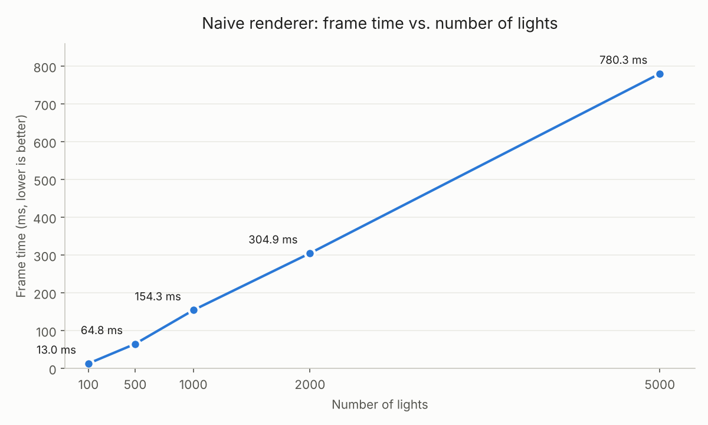
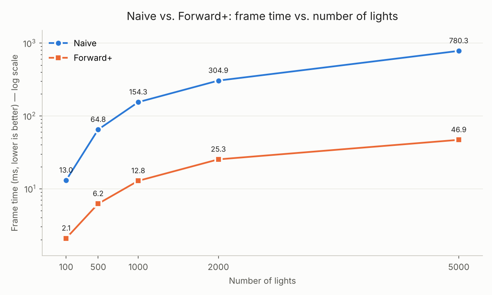
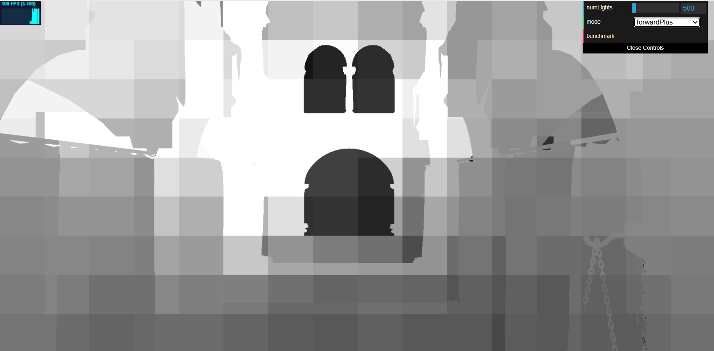
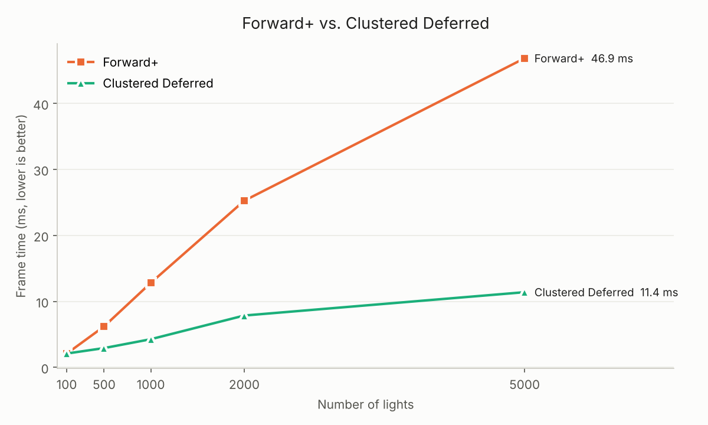
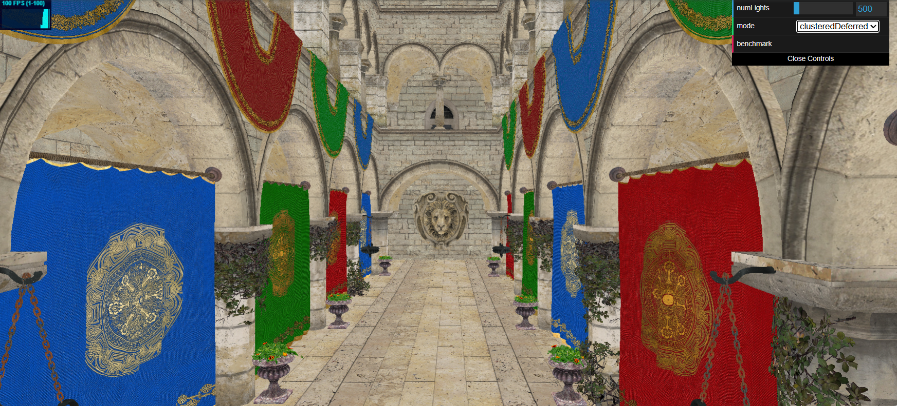
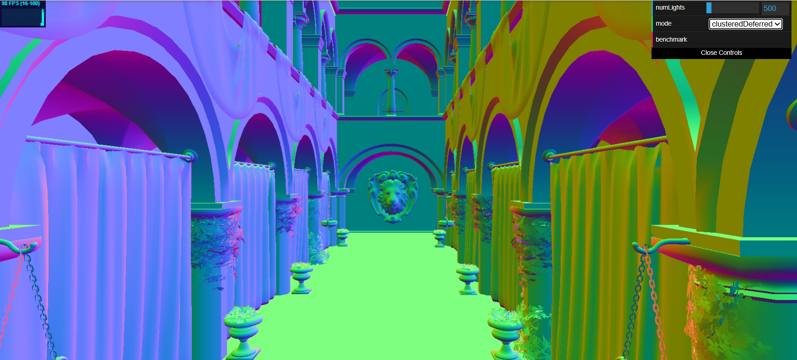

WebGL Forward+ and Clustered Deferred Shading
=============================================

**University of Pennsylvania, CIS 565: GPU Programming and Architecture, Project 4**

* Yunzhe Deng
  * [LinkedIn](https://www.linkedin.com/in/yunzhedeng), [personal website](https://yunzhedeng.com)
* Tested on: Windows 11, Intel Core i7-10750H @ 2.60GHz, 16 GB RAM, NVIDIA GeForce RTX 2060 (Personal Computer)

### Live Demo

### Demo Video/GIF

## Overview

This project is a real-time WebGPU renderer that draws the Sponza scene lit by hundreds to thousands of dynamic point lights. The core question it explores is how to shade a scene with many lights efficiently, so it implements three rendering pipelines that can be switched at runtime from the GUI, then adds a set of optimizations and effects on top of them and measures each one.

### Features

- Naive renderer
- Forward+ renderer
- Clustered Deferred renderer
- Post-processing (bloom or toon shading)
- G-buffer optimization
- Visibility buffer
- Render bundles
- Depth prepass for Forward+
- In-app benchmark tool

### Benchmarking

The built-in FPS counter is driven by `requestAnimationFrame`, which is locked to the display's refresh rate (100 Hz on the test machine), so every renderer faster than 10 ms per frame reads exactly 100 FPS and cannot be compared. To get real
frame times, I added a `benchmark` button to the GUI: it pauses the normal render loop, renders 20 warm-up frames and then 200 frames back-to-back, waits for the GPU to finish, and prints the average **milliseconds per frame** to the browser console. To use it, pick a `mode` and `numLights` in the GUI, click `benchmark`, and read the result in the console. All timings in this README were measured this way.

## Naive Renderer

The baseline renderer. The scene is rasterized once, and the fragment shader loops over every light in the scene, summing each light's contribution. There is no culling of any kind, so every fragment pays for every light, whether or not the light can reach it. Its cost is O(fragments × lights).

The only host-side work this feature needed was a camera uniform buffer holding the view-projection matrix, uploaded every frame and bound to the vertex shader.

### Performance

| numLights | Frame time (ms) | ms per light |
| --------: | --------------: | -----------: |
|       100 |           13.04 |        0.130 |
|       500 |           64.83 |        0.130 |
|      1000 |          154.31 |        0.154 |
|      2000 |          304.90 |        0.152 |
|      5000 |          780.31 |        0.156 |

### Analysis

#### How parameters affect performance

- **Number of lights**: frame time is almost perfectly linear in the number of lights. Going from 100 to 5000 lights (50×) increases frame time 60× (13.0 → 780.3 ms), at a near-constant cost of about 0.13–0.16 ms per light per frame. This is the expected O(lights) behavior: every added light adds one more iteration to every fragment's loop.
- **Light radius**: does not change the cost. Naive evaluates every light at every fragment regardless of distance, so a smaller radius saves nothing.
- **Resolution / overdraw**: The cost is proportional to the number of shaded fragments. Fragments which are hidden by nearby geometry are lit completely, thus increasing the penalty for scenes which are complex in terms of depth (as seen in Sponza).

#### Acceleration

None. This renderer is intentionally the unoptimized reference.

#### How it could be optimized

- **Light culling**: as each light has an effective radius of 2, almost all of the per-fragment processing done is waste. Spatial organization of lights such that a fragment only processes nearby lights is precisely what Forward+ achieves (refer to next section), resulting in a 6-17x speed up.
- **Avoid shading hidden fragments**: a depth prepass or deferred shading would light each visible pixel only once instead of once per overlapping fragment.

---

## 2. Forward+ Renderer(with light clustering)

Forward+ eliminates much of the wasted effort on lighting calculation that occurred due to Naive by doing a pre-calculation step where they determine what lights can possibly have an effect on which portion of the screen. They subdivide the view frustum into 3456 clusters of size 16 x 9 x 24, using exponential depth slices (`z_k = near · (far/near)^(k/24)`), so that the clusters will remain cubical under perspective projection. Each frame, a compute shader is executed, one thread per cluster, which constructs the axis-aligned bounding box for the cluster from its 8 corners in view space, performs a collision test between the light sphere (radius 2) and the bounding box, and stores up to 256 overlapping light indices in a storage buffer. During rendering, each fragment determines the cluster it belongs to using its screen coordinates and view space depth, and iterates over that cluster's lights only.

### Performance

| numLights | Forward+ frame time (ms) |
| --------: | -----------------------: |
|       100 |                     2.08 |
|       500 |                     6.21 |
|      1000 |                    12.82 |
|      2000 |                    25.27 |
|      5000 |                    46.86 |

### Analysis

#### Performance improvement

Forward+ performs 6.3× faster than Naive at 100 lights (13.0 → 2.1 ms), 10.4× faster at 500 lights (64.8 → 6.2 ms), and 16.7× faster at 5000 lights (780.3 → 46.9 ms). The increase in performance scales up with the number of lights, because in Naive we pay for all lights per each fragment, whereas in Forward+ we pay for lights that are close to each fragment. However, Forward+ still increases linearly (2.1 → 46.9 ms), since there is a constant scene volume, so more lights mean more lights in one cluster, which makes the loop of each fragment longer.

#### Best and worst case

- **Best case**: many small, evenly spread lights, so each cluster overlaps only a few of them. Each fragment then loops over a handful of lights instead of thousands, and the speedup over Naive is largest.
- **Worst case**: lights that are large or bunched together, so that many clusters overlap a large fraction of all lights. The per-fragment loop then approaches Naive's, while still paying the extra clustering pass. Once a cluster reaches the 256-light cap, extra lights are dropped from that cluster, which keeps the cost bounded but makes lighting there incorrect.

#### Tradeoffs

Forward+ adds a light-clustering compute pass every frame that tests every light against every cluster (3456 × N sphere–box tests), so its cost grows linearly with the number of lights, and it needs about 3.5 MB of extra GPU memory for the cluster light lists (3456 × (1 + 256) × 4 bytes). The 256-light-per-cluster cap keeps that memory fixed but drops any extra lights in very crowded clusters. Finally, lighting is still evaluated per fragment, so hidden fragments that are later overwritten by closer geometry (overdraw) are still fully lit, a cost that Clustered Deferred removes (see the next section).

#### How parameters affect performance

- **Number of lights**: increases both the clustering pass (linearly) and the per-fragment loop (more lights per cluster).
- **Light radius**: If there is a bigger radius for each light, there will be an increase in the number of clusters that each light overlaps.
- **Cluster grid size**: More clusters lead to denser cluster lists but require more expense for the clustering step and memory use. Fewer clusters do the reverse.

#### Debug view: lights per cluster

*Forward+, 500 lights. Brightness = number of lights in the pixel's cluster / 64 (white means 64 or more).*

The 16 × 9 tiles in the cluster grid are obvious and easily identifiable as blocks of uniform intensity. Within a single tile, intensity will vary based on depth edges (such as those on the arches in the center), since surfaces at different depths will be assigned to different depth slices, demonstrating that the clusters are indeed 3D and not just 2D tiling. The brightest section is that at the far end of the hall in the middle of the screen, since exponential depth slicing gives distant clusters much greater volume and more overlapping lights. It is easy to see how this is reflected in performance – the brighter pixels are those that take the most fragment shader iterations through light loops, so the brighter the screen (more lights, or long hall), the higher the frame time.

---

## 3. Clustered Deferred

Clustered Deferred uses the exact same light clustering compute pass as the Forward+ pipeline does, except Clustered Deferred renders in two passes so that lighting is computed once per visible pixel. The first pass (G-buffer pass) renders the scene without lighting; all the fragment shader does is write the albedo (in `rgba8unorm`), normals (in `rgba16float`), and positions (in `rgba32float`) of surfaces to three render targets, with the depth test making sure only the closest surface per-pixel is rendered. In the second pass, a fullscreen triangle is drawn; the fragment shader looks up the G-buffer using `textureLoad` and computes the pixel's cluster, then iterates through the cluster's lights and generates the final color.

### Performance

| numLights | Clustered Deferred frame time (ms) |
| --------: | ---------------------------------: |
|       100 |                               2.10 |
|       500 |                               2.93 |
|      1000 |                               4.28 |
|      2000 |                               7.86 |
|      5000 |                              11.40 |

### Analysis

#### Performance improvement

Against Forward+, Clustered Deferred scores even at 100 lights (2.08 vs. 2.10 ms), but surpasses it in terms of performance as the number of lights increases: 2.1 times faster at 500 lights (6.21 → 2.93 ms), 3.0 times at 1000 lights, 3.2 times at 2000 lights, and 4.1 times at 5000 lights (46.86 → 11.40 ms). In addition, its time per frame also
rises more slowly than that of Forward+, increasing only 0.002 ms for each additional light versus 0.009 ms for Forward+. Against Naive, it performs 68 times better at 5000 lights (780.3 → 11.4 ms).

#### Best and worst case

- **Best case**: many lights and high overdraw, where many fragments overlap at each pixel. Forward+ would light every one of those fragments; Deferred lights only the one visible surface per pixel, so the savings are largest.
- **Worst case**: few lights and little overdraw. Lighting is then cheap anyway, and the fixed cost of writing and reading the G-buffer cancels out the savings. At 100 lights, Deferred is no faster than Forward+ (2.10 vs. 2.08 ms).

#### Tradeoffs

Deferred requires an additional three full-screen render targets, each taking up 32 bytes per pixel (8 + 8 + 16). These need to be written in the G-buffer pass and re-read in the lighting pass on every frame, requiring additional memory and bandwidth costs that increase with screen resolution. Since G-buffers contain only one surface per pixel, there is no way of handling transparency or forward passes for MSAA, because the transparent surfaces need to be stored separately in their own forward pass.

#### How parameters affect performance

- **Number of lights**: affects only the clustering pass and the lighting pass. Frame time grows from 2.10 to 11.40 ms between 100 and 5000 lights, a farsmaller slope than Forward+ because each light is evaluated at most once per pixel.
- **Resolution**: affects both the G-buffer cost (bytes written and read) and the lighting pass (one evaluation per pixel), but not scene complexity.
- **Scene depth complexity / overdraw**: barely affects lighting cost, since only the closest surface per pixel survives into the G-buffer. This is the main difference from Forward+.

#### Debug view: G-buffer

| Albedo                    | Normal                    |
| ------------------------- | ------------------------- |
|  |  |

The G-buffer stores exactly one surface per pixel: everything hidden behind it has already been discarded by the depth test, which is why the lighting pass does no wasted work on overdraw.

### Forward+ vs. Clustered Deferred

**Is one of them faster?** Clustered Deferred is faster at every light count above 100: 2.1× at 500 lights and 4.1× at 5000 lights. At 100 lights the two tie (2.08 vs. 2.10 ms).

**Is one better at certain workloads?** Deferred is better with many lights and high overdraw, where Forward+ wastes lighting on hidden fragments. Forward+ is better with few lights and little overdraw, where the G-buffer cost is not worth paying, and when transparency, MSAA, or many different materials are needed.

**Benefits and tradeoffs.** Deferred rendering lights every visible pixel only once, and hence is independent of the depth complexity of the scene; however, it has a cost of 32 bytes of G-buffer memory for every pixel and cannot easily manage transparency or MSAA. Forward+ needs no G-buffer and handles any material or transparency, but it lights every rasterized fragment, including those later hidden.

**What causes the difference?** The renderers apply the same clustering pass and the frame for Deferred renderer is computed in just 11.4 ms at 5000 lights; thus, the clustering process takes not more than this time. The additional ~35 ms spent in Forward+ should then be attributed to fragment shading. In Forward+ renderer the loop through cluster lights is executed for each fragment rasterized, while there is lots of overdraw in Sponza (model columns, arches, curtains), which means many fragments are completely lit and then overwritten. In Deferred renderer the loop is executed once for each visible
fragment. With 100 lights, the loop becomes short, and this gain is small and offset by the cost of G-buffer write/read operations.

### Credits

- [Vite](https://vitejs.dev/)
- [loaders.gl](https://loaders.gl/)
- [dat.GUI](https://github.com/dataarts/dat.gui)
- [stats.js](https://github.com/mrdoob/stats.js)
- [wgpu-matrix](https://github.com/greggman/wgpu-matrix)
